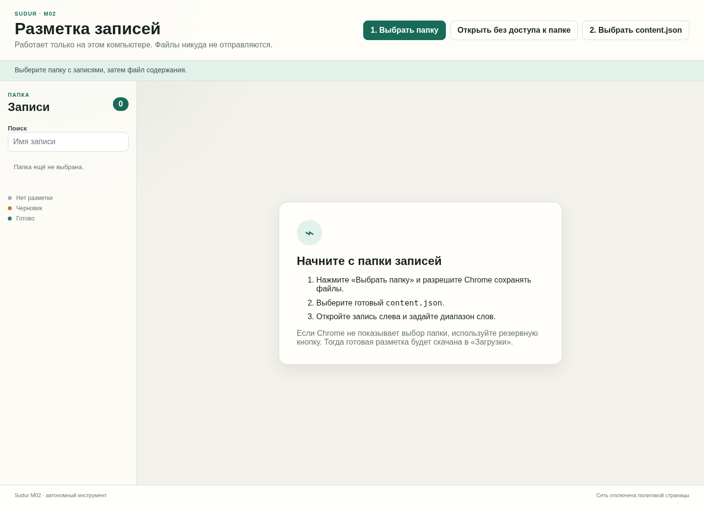
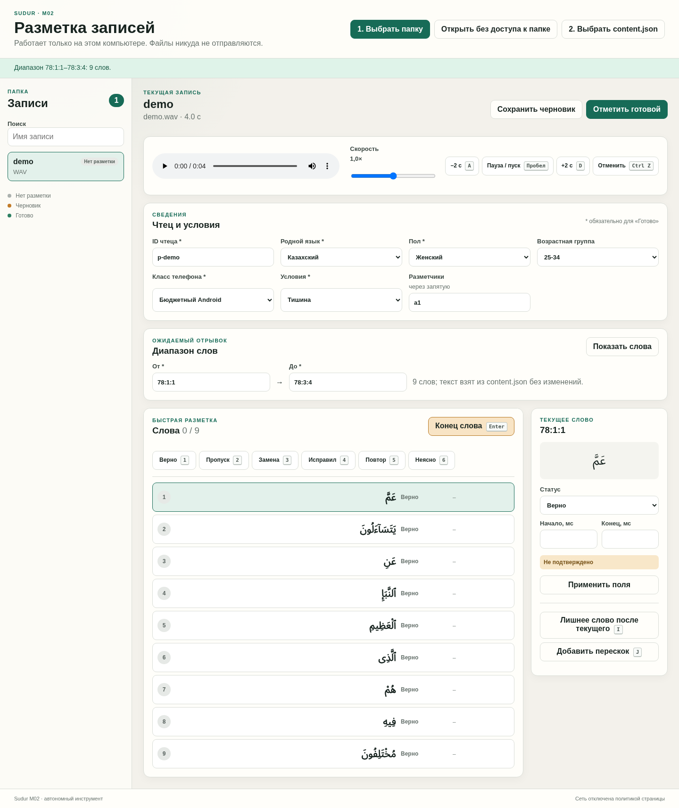

# Разметка записей Sudur

Автономная страница для разметки записей в формате ТЗ 12.6. Она не требует
установки Flutter, Dart или Node, не обращается к сети и не отправляет звук или
текст с компьютера.



## Как открыть на Windows

1. Скопируйте папку `tools/annotate` целиком на компьютер. Файлы `index.html`,
   `app.js` и `styles.css` внутри `web` должны лежать рядом.
2. Откройте `tools/annotate/web/index.html` двойным щелчком. Если Windows
   спросит программу, выберите Google Chrome.
3. Страница должна открыться с адресом, начинающимся с `file:///`. Интернет не
   нужен.

## Подготовка папки

Положите в одну папку:

- записи `wav`, `m4a`, `mp3`, `ogg` или `opus`;
- при наличии — подсказки `<id>.<model>.asr.jsonl`;
- уже начатые файлы `<id>.ann.json`.

Отдельно подготовьте `content.json`, созданный `tools/content_build`, либо
готовый `packages/testing/fixtures/content_p582_583.json`. Страница только
показывает слова из этого файла как есть и никогда не меняет их.

## Как разметить запись

1. Нажмите **«Выбрать папку»**, выберите папку записей и разрешите Chrome
   сохранять изменения. Затем нажмите **«Выбрать content.json»**.
2. Выберите запись слева. Заполните ID чтеца, родной язык, пол, возрастную
   группу, класс телефона и условия записи.
3. Введите ключ первого и последнего ожидаемого слова в виде `78:1:1` и
   нажмите **«Показать слова»**.
4. Запустите запись. На конце каждого слова нажимайте `Enter`: страница
   поставит `startMs`/`endMs` по порядку и перейдёт дальше.
5. Поставьте особый статус перед `Enter`, если слово прочитано не обычно.
   Для замены заполните «Что услышано». Для самоисправления заполните время
   исправления `correction.afterMs`.
6. Сохраняйте промежуточную работу кнопкой **«Сохранить черновик»**. Когда все
   слова подтверждены, нажмите **«Отметить готовой»**.



Если прямой выбор папки недоступен, нажмите **«Открыть без доступа к папке»**.
В этом режиме JSON скачивается в папку «Загрузки»; вручную перенесите его к
записи. В обычном режиме `<id>.ann.json` сохраняется рядом с аудиофайлом.

## Горячие клавиши

| Клавиша | Действие |
|---|---|
| `Пробел` | пауза / продолжить |
| `Enter` | конец текущего слова и переход к следующему |
| `1`…`6` | верно, пропуск, замена, самоисправление, повтор, неразборчиво |
| `A` / `D` | назад / вперёд на 2 секунды |
| `Ctrl+Z` | отменить последнее изменение |
| `I` | добавить лишнее слово после текущего |
| `J` | добавить перескок |

Горячие клавиши не срабатывают, пока курсор находится в текстовом поле.

## Подсказка распознавания

Если рядом с записью лежит `<id>.<model>.asr.jsonl`, страница показывает
финальный распознанный текст и времена токенов. Это только подсказка: она не
заполняет статусы, услышанный текст или времена разметки. Каждое слово нужно
подтвердить вручную.

## Проверка формата разработчиком

Из корня репозитория:

```console
dart run tools/annotate/bin/validate.dart <папка-с-разметкой>
```

Команда читает каждый `.ann.json` публичным парсером `tools/eval` и возвращает
ненулевой код при любой ошибке. Она также проверяет совпадение `recordingId` с
именем файла, порядок слов, времена, поле `heard` у замены и `correction` у
самоисправления.

## Что проверить владельцу

- открыть страницу двойным щелчком в Chrome на Windows без сети;
- дать доступ к реальной папке и убедиться, что JSON сохраняется рядом с записью;
- открыть сохранённый черновик повторно;
- проверить воспроизведение каждого используемого формата аудио;
- разметить одну минуту записи и проверить, что это занимает не больше двух минут;
- запустить проверку готового файла через помощника, у которого есть Dart.
